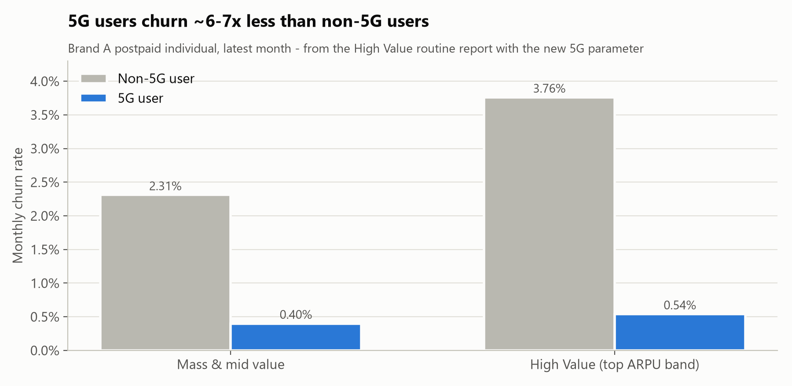
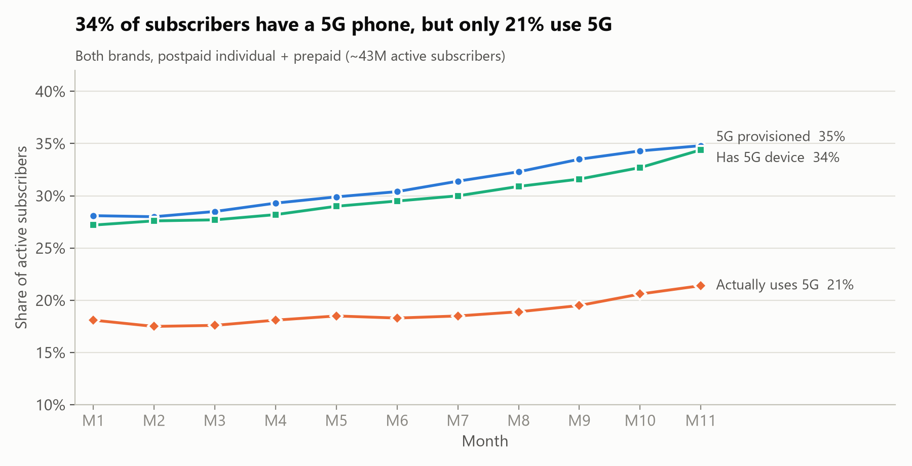
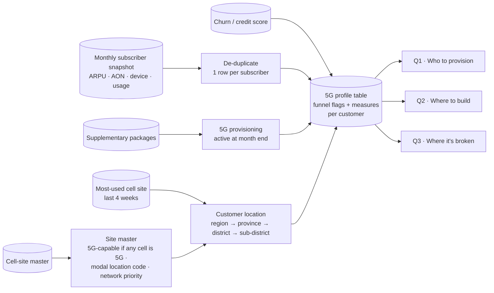
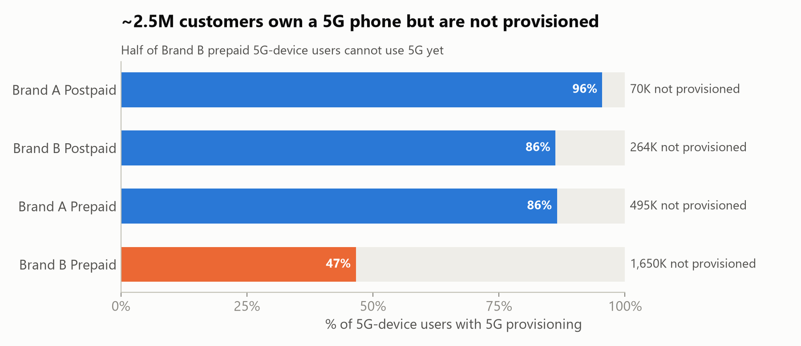
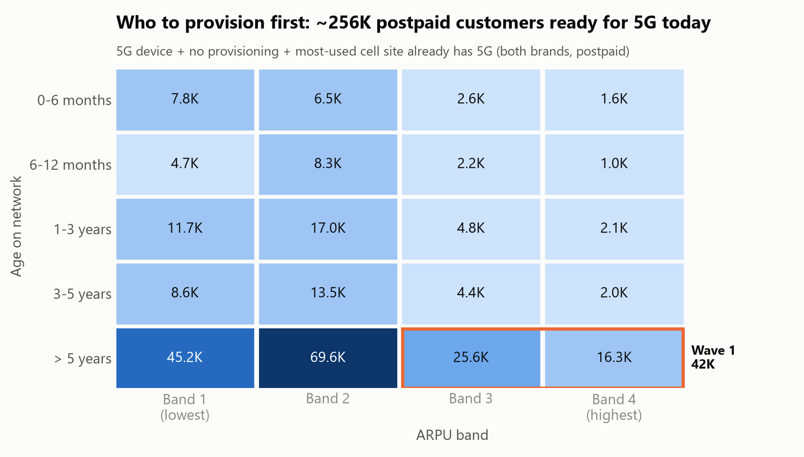
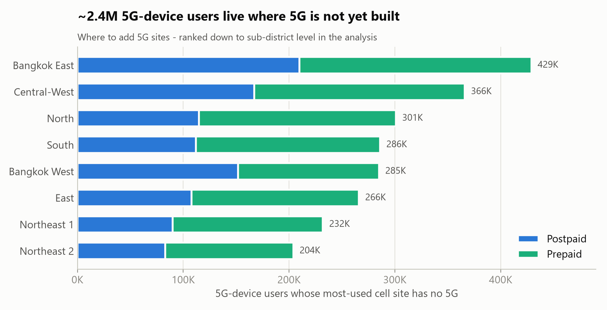
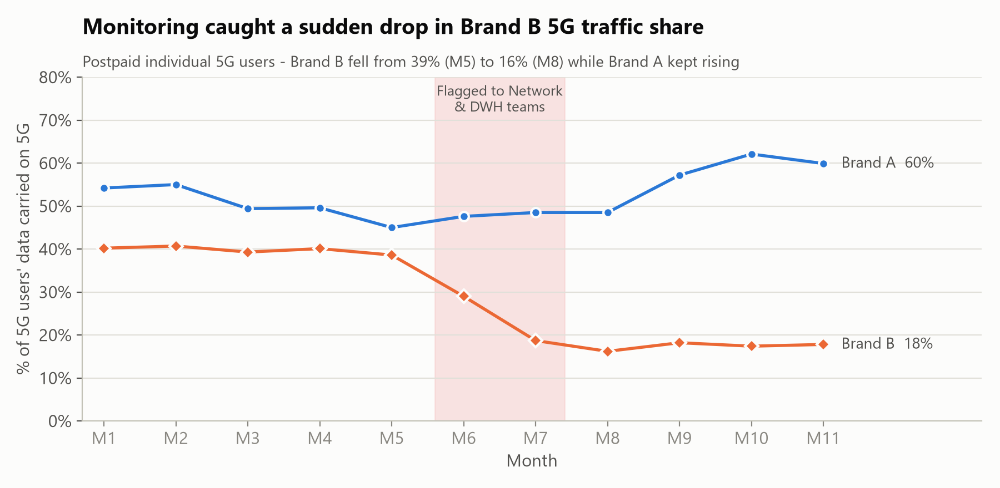

# 5G Customer Analytics — High Value Monitoring & 5G Provisioning Prioritisation

**Mobile · Customer Value Management · Thai mobile operator (two brands) · 2025**

> **About the numbers.** This is real work done on production data. To protect confidential information, all figures are **rescaled**: counts are scaled, rates are slightly perturbed, and money is shown as an index. Brand and location names are anonymised. **The patterns, rankings and conclusions are the same as in the original analysis.**

Two pieces of work that put 5G into customer analytics:

1. **High Value report + 5G parameter.** I added 5G flags (device, provisioning, actual usage) to the routine High Value Customer report, so 5G users can be tracked over time by ARPU, churn and downsell, for both brands, Postpaid and Prepaid.
2. **5G Provisioning prioritisation framework.** I joined subscriber, device, provisioning and usage data with each customer's **most-used cell site** and its 5G coverage. The result answers three business questions for the commercial and network teams.

> ### Headline numbers (~43M active subscribers, rescaled)
> - **34%** of subscribers own a 5G phone, but only **21%** actually use 5G.
> - **~2.5M** customers have a 5G phone but no 5G provisioning. **~1.9M of them already sit on a 5G-covered site**, so provisioning alone would switch them on.
> - **~2.4M** 5G-device users live where their main cell site has no 5G, ranked down to sub-district level for network planning.
> - 5G users churn **~6–7× less** than non-5G users in the same value band.

---

## Part 1 — High Value report with a 5G parameter

The High Value (HV) report is a monthly management report on **Postpaid Individual** customers (~12.9M across both brands). HV customers (the top ARPU band) are **~21% of subscribers but ~49% of revenue**. The report tracks four flows: active base, churn, upsell and downsell.

### What I changed
Three new dimensions were added to all four flows:

| Flag | Definition |
|---|---|
| `DVC_SUPPORT_FLAG` | Handset supports 5G |
| `PROVISIONING_5G_FLAG` | Active "5G Provisioning" supplementary package on the snapshot date |
| `USAGE_5G_FLAG` | Any data consumed on 5G in the month |

**Point-in-time joins.** Each flow takes the 5G status from the moment that matters, so no flag "leaks" from after the event:

| Flow | Snapshot used for the 5G flags |
|---|---|
| Active base | Same month |
| Churn | Customer's **last active month** before churn |
| Upsell / downsell (plan change) | **Month before** the change |

The new output was reconciled against the existing HV report (subscriber counts, revenue, outflow value, downsell) before it replaced the old one.

### What it shows (Brand A Postpaid Individual)



ARPU is indexed so that a non-HV, non-5G customer = 100.

| | Non-5G user | 5G user | Ratio |
|---|---|---|---|
| ARPU index, mass & mid value | 100 | 148 | **1.5×** |
| ARPU index, High Value | 475 | 500 | 1.05× |
| Monthly churn, mass & mid value | 2.31% | 0.40% | ÷5.8 |
| Monthly churn, High Value | 3.76% | 0.54% | ÷7.0 |

- 5G users grew from **38% to 45%** of Brand A postpaid during the year. Brand B postpaid grew from 27% to 28%.
- *Caveat:* this is an association, not a causal effect. 5G users tend to have newer handsets and higher engagement. It does make 5G status a useful **retention signal** to monitor.

SQL: [`sql/01_high_value_report_5g_parameter.sql`](sql/01_high_value_report_5g_parameter.sql)

---

## Part 2 — 5G Provisioning prioritisation framework

### The adoption gap



5G users have **~1.8×** the network-average ARPU and consume **~1.7×** the data. Each step of the funnel *device → provisioning → coverage → usage* where customers drop out is therefore lost value. The framework locates the drop-off for each customer.

### Data model



### Q1 — Which customers should get 5G provisioning first?



The target is customers with a **5G device**, **no provisioning**, and whose **most-used site already broadcasts 5G**: ~256K postpaid + ~1.68M prepaid. They are ranked by ARPU band × age on network (AON), then by churn-score band:



- **Wave 1:** ~42K long-tenure (> 5 years), high-ARPU (top two bands) postpaid customers. These are the most valuable and most loyal customers who are not yet getting 5G.
- **Wave 2:** the ~115K long-tenure customers in the two lower ARPU bands, ordered by churn-score band so the riskiest are switched on first.
- **Brand B prepaid is the biggest pool** (~1.26M on 5G-covered sites). A bulk provisioning campaign there would move the overall numbers most.

### Q2 — Where should new 5G cell sites go?



These are 5G-device users whose most-used site has **no 5G**, ranked by device count and the revenue at stake:

| Rank | Sub-district | 5G-device users (postpaid) | Device penetration |
|---|---|---|---|
| 1 | Bangkok – district A | ~9.0K | 64% |
| 2 | Bangkok – district B | ~7.3K | 63% |
| 3 | Bangkok – district C | ~5.4K | 63% |
| 4 | Bangkok metro – district D | ~5.2K | 63% |
| 5 | Bangkok – district E | ~4.8K | 65% |

For prepaid, the list is led by a beach-resort city, a north-eastern city centre and an island resort area.

### Q3 — Where do customers have everything but still don't use 5G?

These customers have a 5G device, provisioning **and** a 5G-covered site, yet no 5G traffic. There are **~0.97M postpaid and ~1.59M prepaid** of them. Across regions the non-usage rate is a fairly steady baseline: 13–22% for postpaid and 22–27% for prepaid.

The **outliers** are what the network team needs:

| Area | Non-5G-user rate | Typical regional rate |
|---|---|---|
| Industrial suburb, Bangkok metro | **75%** postpaid / **73%** prepaid | 13–22% / 22–27% |
| Border town 1 (north) | **77%** prepaid | 22–27% |
| Border town 2 (east) | **61%** prepaid | 22–27% |
| Border town 3 (west) | **40%** prepaid | 22–27% |

Three of the top outliers are **border towns**, which is worth checking for cross-border signal or site configuration issues. The ranked hotspot list is produced as a dedicated network-team extract.

### Data-quality catch



While building the monthly 5G performance view, I noticed that Brand B's share of 5G-user traffic carried on 5G fell from **39% to 16%** within three months, while Brand A's kept rising. A shift that sudden is unlikely to be customer behaviour, so I flagged it in the report and raised it with the Network and DWH teams for root-cause investigation.

SQL: [`sql/02_5g_profile_cell_site_prioritisation.sql`](sql/02_5g_profile_cell_site_prioritisation.sql)

---

## Engineering notes

- **Snapshot de-duplication** with Vertica's `LIMIT 1 OVER (PARTITION BY MNTH_ID, SUBR_ID ORDER BY …)`, keeping one row per subscriber when the monthly snapshot has duplicates.
- **Site-level 5G flag.** A site has many cells, so `MAX(DECODE(SYSTEM_TYPE,'5G',1,0))` marks the site 5G-capable if any cell is.
- **Resolving conflicting geography.** Some sites map to several location codes, so each site takes its most frequent code (`LIMIT 1 OVER (… ORDER BY COUNT DESC)`).
- **Network context.** The upcoming network-priority list (P0/P1/P2 impacted sites) is joined so the business and network teams see the same site status.
- **One wide profile table, several audiences.** Measures are pre-aggregated per funnel stage (device, provisioned, user: counts, revenue, data). Separate extracts serve the *business* view (ARPU × AON × churn band) and the *network* view (region → sub-district), all from one table.

**What I'd improve:** move the 5G flag logic, which is currently repeated in both scripts, into one shared view. Parameterise the run month. Replace the `DVC_SUPPORT LIKE '%5G%'` device rule with a maintained device-capability dimension.

---

## Repository

```
├── README.md
├── docs/
│   ├── make_charts.py      # renders all charts (rescaled figures)
│   └── images/
└── sql/
    ├── 01_high_value_report_5g_parameter.sql
    └── 02_5g_profile_cell_site_prioritisation.sql
```

**Tools:** SQL (Vertica: analytic `LIMIT … OVER`, window functions, MPP segmentation) · Excel (pivot-based reporting)

> *The SQL logic is shared as written in production. Schema and brand names are anonymised. No customer-level data is included.*
